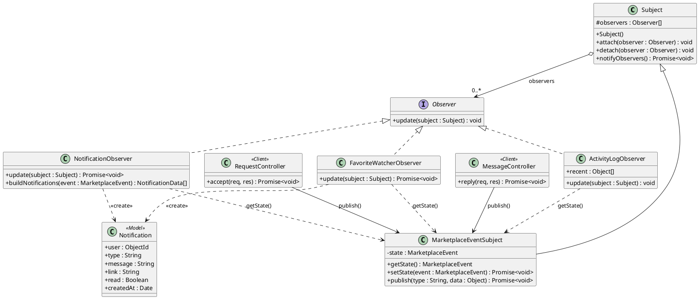

# Observer Design Pattern Specification

**Component Owner:** Jayant (T09)  
**Implementation:** `src/patterns/observer/`  
**Automated Tests:** `test/observer.test.js`  

---

## 1. Design Pattern Overview (GoF Specification)

| Attribute | Specification |
|---|---|
| **Pattern Name** | Observer |
| **Classification** | Behavioral |
| **Intent** | Define a one-to-many dependency between objects so that when the marketplace event subject changes state, all registered observers are notified and updated automatically. |
| **Also Known As** | Publish–Subscribe, Dependents |
| **Motivation** | Marketplace actions frequently trigger multiple side effects across different users. When a seller accepts a purchase request, the offering buyer must be notified of acceptance, competing buyers with pending offers on that same appliance must be notified that the item was reserved, users who bookmarked the appliance in their favorites must be alerted of the availability change, and the system audit log must record the transaction. Embedding notification queries, favorite lookups, and logging directly inside `requestController.accept()` would violate Single Responsibility and tightly couple controllers to secondary subsystems. |
| **Solution** | Controllers publish domain state changes to a single subject (`MarketplaceEventSubject`). The subject maintains a collection of `Observer` instances and invokes `update(this)` on each attached observer whenever its state changes. Each concrete observer (`NotificationObserver`, `FavoriteWatcherObserver`, `ActivityLogObserver`) independently pulls the current event via `subject.getState()` and executes its domain reaction. |
| **Applicability** | Applied when: (1) a state transition in one object requires updating multiple dependent objects whose count or concrete types may vary, (2) the subject should broadcast updates without coupling to concrete observer implementations, and (3) new event reactions must be extensible without modifying existing controllers. |
| **Participants** | • **Subject:** `Subject` (`attach`, `detach`, `notifyObservers`)<br>• **ConcreteSubject:** `MarketplaceEventSubject` (`getState`, `setState`, `publish`)<br>• **Observer Interface:** `Observer` (`update(subject)`)<br>• **ConcreteObservers:** `NotificationObserver`, `FavoriteWatcherObserver`, `ActivityLogObserver` |
| **Collaborations** | A controller invokes `marketplaceEvents.publish(type, data)`, which delegates to `setState()`. `setState()` updates the internal event state and invokes `notifyObservers()`. Each concrete observer's `update(subject)` method pulls the state using `subject.getState()` and performs its respective database or logging operation. |
| **Consequences** | **Benefits:**<br>• Loose coupling between HTTP controllers and notification/logging subsystems.<br>• Open/Closed Principle compliance: new observers can be attached without altering controller logic.<br>• Fault isolation: `notifyObservers()` executes observers via `Promise.allSettled`, ensuring an error in one observer never aborts another observer or breaks the primary user response.<br><br>**Trade-offs:**<br>• Observers are invoked on every published event and filter for relevant event types before acting. |
| **Implementation Details** | Implemented completely from scratch without Node.js `EventEmitter`. Strictly follows the GoF **Pull Model** (`update(subject)` paired with `subject.getState()`). Observers synchronously read `subject.getState()` prior to any asynchronous `await` point, ensuring state consistency across concurrent requests. |

---

## 2. Pattern Usability in ApplianceHub

| Marketplace Event (`type`) | Publishing Controller | Reacting Observers | User-Facing Outcome |
|---|---|---|---|
| `request.created` | `requestController.create` | `NotificationObserver`, `ActivityLogObserver` | Seller receives notification: *"<Buyer> sent a purchase request for <Title> ($<Offer>)"* |
| `request.accepted` | `requestController.accept` | `NotificationObserver`, `ActivityLogObserver` | Offering buyer receives notification: *"<Seller> accepted your request for <Title>!"* |
| `request.rejected` | `requestController.accept`, `requestController.reject`, `listingController.remove` | `NotificationObserver`, `ActivityLogObserver` | Buyer receives notification: *"Your request for <Title> was declined. Reason: <Note>"* |
| `request.cancelled` | `requestController.cancel`, `requestController.release`, `listingController.remove` | `NotificationObserver`, `ActivityLogObserver` | Counterparty receives notification: *"<User> cancelled the purchase request for <Title>"* |
| `request.completed` | `requestController.complete` | `NotificationObserver`, `ActivityLogObserver` | Buyer receives notification with review link: *"Sale completed! Leave a review for <Seller>"* |
| `message.sent` | `messageController.start`, `messageController.reply` | `NotificationObserver`, `ActivityLogObserver` | Recipient receives grouped conversation alert: *"New message from <Sender>"* |
| `listing.statusChanged` | `requestController.accept`, `requestController.complete`, `listingController.updateStatus` | `FavoriteWatcherObserver`, `ActivityLogObserver` | Users who saved the listing in Favorites are alerted: *"An appliance you saved (<Title>) was just sold / reserved / is available again"* |
| `review.created` | `reviewController.create` | `NotificationObserver`, `ActivityLogObserver` | Seller receives notification: *"<Buyer> left you a <N>★ review"* |

---

## 3. Class Structure, Attributes, and Method Prototypes

### Base Subject: `Subject`
| Visibility | Member | Data Type / Method Prototype |
|:---:|---|---|
| `#` | `observers` | `Observer[]` |
| `+` | `Subject` | `Subject()` *(constructor)* |
| `+` | `attach` | `attach(observer: Observer): void` |
| `+` | `detach` | `detach(observer: Observer): void` |
| `+` | `notifyObservers` | `notifyObservers(): Promise<void>` |

### Concrete Subject: `MarketplaceEventSubject` (`extends Subject`)
| Visibility | Member | Data Type / Method Prototype |
|:---:|---|---|
| `-` | `state` | `MarketplaceEvent` (`{type: String, data: Object, occurredAt: Date} \| null`) |
| `+` | `getState` | `getState(): MarketplaceEvent` |
| `+` | `setState` | `setState(event: {type: String, data: Object}): Promise<void>` |
| `+` | `publish` | `publish(type: String, data: Object): Promise<void>` |

### Observer Interface: `Observer`
| Visibility | Method Prototype |
|:---:|---|
| `+` | `update(subject: Subject): void \| Promise<void>` *(abstract)* |

### Concrete Observers (`extends Observer`)

**`NotificationObserver`**
| Visibility | Method Prototype |
|:---:|---|
| `+` | `update(subject: Subject): Promise<void>` |
| `+` | `buildNotifications(event: MarketplaceEvent): NotificationData[]` |

**`FavoriteWatcherObserver`**
| Visibility | Method Prototype |
|:---:|---|
| `+` | `update(subject: Subject): Promise<void>` |

**`ActivityLogObserver`**
| Visibility | Member / Prototype |
|:---:|---|
| `+` | `recent: {type: String, at: Date, data: Object}[]` |
| `+` | `update(subject: Subject): void` |
| `+` | `getRecent(): Object[]` |
| `+` | `clear(): void` |

### UML Class Diagram (PlantUML Definition)


### Runtime Interaction Sequence (Accept Purchase Request)
```
Seller -> RequestController.accept()
  -> MarketplaceEventSubject.publish('request.accepted', data)
    -> setState(event)
      -> notifyObservers()
        -> NotificationObserver.update(subject)    : subject.getState() -> Notification.create(buyer)
        -> FavoriteWatcherObserver.update(subject) : subject.getState() -> ignores non-status event
        -> ActivityLogObserver.update(subject)     : subject.getState() -> records event in audit log
```

---

## 4. Method Algorithms

### `Subject.attach(observer)`
```
1. if observer is not an instance of Observer → throw TypeError
2. if observer is not already present in this.observers → append observer
```

### `Subject.detach(observer)`
```
1. this.observers ← filter this.observers to exclude observer
```

### `Subject.notifyObservers()`
```
1. tasks ← map each observer in this.observers to Promise.resolve().then(() => observer.update(this))
2. results ← await Promise.allSettled(tasks)
3. for each result in results where result.status = 'rejected':
4.   log error to console without interrupting other observers
```

### `MarketplaceEventSubject.getState()`
```
1. return this.state
```

### `MarketplaceEventSubject.setState(event)`
```
1. if event is null or event.type ∉ EVENT_TYPES → throw Error("Unknown marketplace event")
2. this.state ← { type: event.type, data: event.data or {}, occurredAt: new Date() }
3. await this.notifyObservers()
```

### `MarketplaceEventSubject.publish(type, data)`
```
1. return this.setState({ type, data })
```

### `NotificationObserver.update(subject)`
```
1. event ← subject.getState()
2. items ← this.buildNotifications(event)
3. for each item in items where item.user is defined:
4.   if event.type = 'message.sent':
5.     upsert unread Notification matching { user: item.user, type: 'message.sent', link: item.link, read: false }
6.   else:
7.     create new Notification(item)
```

### `NotificationObserver.buildNotifications(event)`
```
1. switch (event.type)
2.   case 'request.created'   : return [{ user: sellerId, message: "<buyer> sent a purchase request...", link: '/requests/received' }]
3.   case 'request.accepted'  : return [{ user: buyerId,  message: "<seller> accepted your request...",  link: '/requests/sent' }]
4.   case 'request.rejected'  : return [{ user: buyerId,  message: "Your request was declined...",       link: '/requests/sent' }]
5.   case 'request.cancelled' : return [{ user: recipientId, message: "<actor> cancelled the request...", link: targetLink }]
6.   case 'request.completed' : return [{ user: buyerId,  message: "Sale completed! Leave a review...", link: '/reviews/new?request=' + id }]
7.   case 'message.sent'      : return [{ user: recipientId, message: "New message from <sender>...",    link: '/messages/' + conversationId }]
8.   case 'review.created'    : return [{ user: sellerId, message: "<buyer> left you a <rating>★ review", link: '/users/' + sellerId + '#reviews' }]
9.   default                  : return []
```

### `FavoriteWatcherObserver.update(subject)`
```
1. event ← subject.getState()
2. if event.type ≠ 'listing.statusChanged' → return
3. statusMessage ← lookup status description for event.data.status ('pending', 'sold', 'available')
4. if statusMessage is undefined → return
5. watchers ← query User collection where favorites contains listingId and _id ≠ exceptUserId
6. if watchers is empty → return
7. bulk insert Notification documents for each watcher
```

### `ActivityLogObserver.update(subject)`
```
1. event ← subject.getState()
2. prepend { type: event.type, at: event.occurredAt, data: event.data } to this.recent
3. if length(this.recent) > MAX_ENTRIES (100) → truncate oldest entries
4. if event logging enabled → output formatted timestamp and event type to stdout
```
