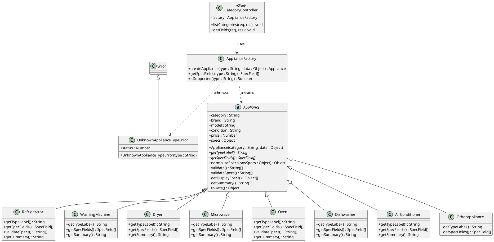

# Simple Factory Design Pattern Specification

**Component Owner:** Jaspreet (T03)  
**Implementation:** `src/patterns/factory/`  
**Automated Tests:** `test/factory.test.js`  

---

## 1. Design Pattern Overview (GoF Specification)

| Attribute | Specification |
|---|---|
| **Pattern Name** | Simple Factory |
| **Classification** | Creational |
| **Intent** | Encapsulate the instantiation of category-specific appliance objects inside a single factory class so client modules interact exclusively with the abstract `Appliance` interface. |
| **Also Known As** | Static Factory |
| **Motivation** | ApplianceHub supports eight distinct appliance categories, each requiring specialized technical specifications and domain validation rules. For example, a refrigerator defines a door style, total capacity in litres, and freezer volume (where freezer volume cannot exceed total volume); an air conditioner defines cooling output in BTU and coverage area in square feet; a wall oven cannot specify stovetop burners. Without a centralized factory, `listingController`, `categoryController`, and `compareController` would duplicate conditional branching (`if/else` or `switch`) across creation, editing, display, and comparison workflows. |
| **Solution** | `ApplianceFactory.createAppliance(type, data)` centralizes category resolution and returns an instance of the abstract base class `Appliance`. Client controllers invoke polymorphic methods (`validate()`, `getSpecFields()`, `getSummary()`, `getDisplaySpecs()`, `toData()`) without coupling to concrete product classes. |
| **Applicability** | Applied when: (1) a client cannot anticipate which concrete class among a family of appliance products to instantiate ahead of time, (2) instantiation depends on runtime user input (the selected category), and (3) creation and specification logic must remain centralized across multiple views and controllers. |
| **Participants** | • **Clients:** `categoryController`, `listingController`, `compareController`<br>• **Factory:** `ApplianceFactory`<br>• **Abstract Product:** `Appliance`<br>• **Concrete Products:** `Refrigerator`, `WashingMachine`, `Dryer`, `Microwave`, `Oven`, `Dishwasher`, `AirConditioner`, `OtherAppliance` |
| **Collaborations** | The client invokes `factory.createAppliance(category, formData)`. The factory instantiates the matching concrete product and returns it typed as `Appliance`. The client validates and formats data polymorphically through the `Appliance` interface. |
| **Consequences** | **Benefits:**<br>• Eliminates duplicate conditional branching across controllers (DRY).<br>• Decouples HTTP controllers from concrete product classes.<br>• Dynamically drives UI form generation via `getSpecFields()`.<br>• Facilitates isolated unit testing (verified via 13 automated test cases).<br><br>**Trade-offs:**<br>• Adding a new appliance category requires registering the new subclass inside `ApplianceFactory.createAppliance`. |
| **Implementation Details** | Because JavaScript lacks a native `abstract` keyword, `Appliance` enforces abstraction at runtime by checking `new.target === Appliance` in its constructor and throwing a `TypeError` if instantiated directly. Unimplemented abstract methods (`getTypeLabel()`, `getSpecFields()`) throw errors if not overridden. Unrecognized category keys throw `UnknownApplianceTypeError` (mapped to HTTP 400/404). |

---

## 2. Pattern Usability in ApplianceHub

| System Use Case | Client Module | Pattern Integration |
|---|---|---|
| **Create Listing (Seller)** | `listingController.create` | Calls `factory.createAppliance(req.body.category, req.body)` followed by `validate()`. On validation success, persists `toData()` to MongoDB. Category-specific constraint violations (e.g., freezer capacity exceeding total fridge capacity) are returned to the form. |
| **Edit Listing (Seller)** | `listingController.update` | Executes the identical polymorphic validation pipeline as listing creation without duplicating category rules. |
| **Dynamic Category Form (Seller)** | `categoryController.getFields` | Serves `GET /api/categories/:key/fields`; invokes `factory.getSpecFields(key)` so the browser dynamically renders category-specific form inputs. |
| **View Listing Details (Buyer)** | `listingController.show` | Reconstructs the concrete appliance instance from stored database fields and calls `getDisplaySpecs()` to format technical specifications with appropriate units (e.g., `790 L`, `44 dB`, `10,000 BTU`). |
| **Compare Appliances (Buyer)** | `compareController.show` | Uses `getDisplaySpecs()` across up to three products to align technical attributes in a side-by-side comparison table. |
| **Automatic Title Generation** | `listingController.create` | Uses `getSummary()` to generate descriptive default titles when the seller leaves the title blank (e.g., `"Samsung French Door Refrigerator, 790 L"`). |

---

## 3. Class Structure, Attributes, and Method Prototypes

### Abstract Product: `Appliance`
| Visibility | Member | Data Type / Method Prototype |
|:---:|---|---|
| `+` | `category` | `String` |
| `+` | `brand` | `String` |
| `+` | `model` | `String` |
| `+` | `condition` | `String` |
| `+` | `price` | `Number` |
| `+` | `specs` | `Object` (`Map<String, Number \| String>`) |
| `+` | `Appliance` | `Appliance(category: String, data: Object)` *(constructor)* |
| `+` | `getTypeLabel` | `getTypeLabel(): String` *(abstract)* |
| `+` | `getSpecFields` | `getSpecFields(): SpecField[]` *(abstract)* |
| `+` | `normalizeSpecs` | `normalizeSpecs(rawSpecs: Object): Object` |
| `+` | `validate` | `validate(): String[]` |
| `+` | `validateSpecs` | `validateSpecs(): String[]` |
| `+` | `getDisplaySpecs` | `getDisplaySpecs(): {label: String, value: String}[]` |
| `+` | `getSummary` | `getSummary(): String` |
| `+` | `toData` | `toData(): Object` |

### Concrete Products (`extends Appliance`)
All concrete product classes override `getTypeLabel(): String` and `getSpecFields(): SpecField[]`.

| Concrete Class | Additional Method Overrides | Category Specification Attributes (`specs`) |
|---|---|---|
| `Refrigerator` | `validateSpecs()`, `getSummary()` | `style: String`, `capacityLiters: Number`, `freezerLiters: Number`, `energyStar: String` |
| `WashingMachine` | `getSummary()` | `loadType: String`, `capacityKg: Number`, `maxSpinRpm: Number` |
| `Dryer` | `getSummary()` | `fuelType: String`, `capacityKg: Number`, `ventless: String` |
| `Microwave` | `getSummary()` | `installation: String`, `powerWatts: Number`, `capacityLiters: Number` |
| `Oven` | `validateSpecs()`, `getSummary()` | `ovenType: String`, `fuelType: String`, `burners: Number` |
| `Dishwasher` | `getSummary()` | `installation: String`, `placeSettings: Number`, `noiseDb: Number` |
| `AirConditioner` | `getSummary()` | `acType: String`, `btu: Number`, `coverageSqFt: Number` |
| `OtherAppliance` | *(inherits defaults)* | `applianceType: String` |

### Factory: `ApplianceFactory`
| Visibility | Method Prototype |
|:---:|---|
| `+` | `createAppliance(type: String, data: Object): Appliance` |
| `+` | `getSpecFields(type: String): SpecField[]` |
| `+` | `isSupported(type: String): Boolean` |

### Client: `CategoryController`
| Visibility | Member / Prototype |
|:---:|---|
| `-` | `factory: ApplianceFactory` |
| `+` | `listCategories(req: Request, res: Response): void` |
| `+` | `getFields(req: Request, res: Response): void` |

### Domain Exception: `UnknownApplianceTypeError` (`extends Error`)
| Visibility | Member / Prototype |
|:---:|---|
| `+` | `status: Number` |
| `+` | `UnknownApplianceTypeError(type: String)` |

### UML Class Diagram (PlantUML Definition)


---

## 4. Method Algorithms

### `ApplianceFactory.createAppliance(type, data)`
```
1. switch (type)
2.   case 'refrigerator'    : return new Refrigerator(data)
3.   case 'washer'          : return new WashingMachine(data)
4.   case 'dryer'           : return new Dryer(data)
5.   case 'microwave'       : return new Microwave(data)
6.   case 'oven'            : return new Oven(data)
7.   case 'dishwasher'      : return new Dishwasher(data)
8.   case 'air_conditioner' : return new AirConditioner(data)
9.   case 'other'           : return new OtherAppliance(data)
10.  default                : throw new UnknownApplianceTypeError(type)
```

### `ApplianceFactory.getSpecFields(type)`
```
1. product ← createAppliance(type, {})
2. return product.getSpecFields()
```

### `ApplianceFactory.isSupported(type)`
```
1. try:
2.   createAppliance(type, {})
3.   return true
4. catch UnknownApplianceTypeError:
5.   return false
```

### `Appliance.constructor(category, data)`
```
1. if new.target = Appliance → throw TypeError("Appliance is an abstract class")
2. this.category ← category
3. this.brand ← trim(data.brand or "")
4. this.model ← trim(data.model or "")
5. this.condition ← trim(data.condition or "")
6. this.price ← NaN if data.price is empty, else Number(data.price)
7. this.specs ← normalizeSpecs(data.specs or {})
```

### `Appliance.normalizeSpecs(rawSpecs)`
```
1. clean ← {}
2. for each field in getSpecFields():
3.   raw ← rawSpecs[field.name]
4.   if raw is undefined or empty string → continue
5.   clean[field.name] ← Number(raw) if field.type = 'number' else trim(raw)
6. return clean
```

### `Appliance.validate()`
```
1. errors ← []
2. if brand is empty → append "Brand is required"; else if length > 40 → append length error
3. if model length > 60 → append length error
4. if condition ∉ CONDITIONS → append invalid condition error
5. if price is NaN → append "Price is required"; else if price < 0 or price > 100000 → append range error
6. return errors concatenated with validateSpecs()
```

### `Appliance.validateSpecs()`
```
1. errors ← []
2. for each field in getSpecFields():
3.   value ← specs[field.name]
4.   if value is missing:
5.     if field.required → append "<field.label> is required"
6.     continue
7.   if field.type = 'number':
8.     if value is NaN → append number error
9.     else if value < field.min or value > field.max → append bounds error
10.  if field.type = 'select' and value ∉ field.options → append option error
11.  if field.type = 'text' and length(value) > 60 → append length error
12. return errors
```

### `Refrigerator.validateSpecs()` *(Polymorphic Override)*
```
1. errors ← super.validateSpecs()
2. if specs.capacityLiters > 0 and specs.freezerLiters > specs.capacityLiters:
3.   append "Freezer capacity cannot be larger than the total capacity."
4. return errors
```

### `Oven.validateSpecs()` *(Polymorphic Override)*
```
1. errors ← super.validateSpecs()
2. if specs.ovenType = 'Wall Oven' and specs.burners > 0:
3.   append "A wall oven cannot have stovetop burners."
4. return errors
```

### `Appliance.getDisplaySpecs()`
```
1. result ← []
2. for each field in getSpecFields():
3.   if specs[field.name] is defined:
4.     formattedValue ← specs[field.name] + (field.unit ? " " + field.unit : "")
5.     append { label: field.label, value: formattedValue }
6. return result
```

### `Appliance.getSummary()` & `Appliance.toData()`
- `getSummary()`: Concatenates non-empty `[brand, model, getTypeLabel()]` separated by spaces. Subclasses override this to include primary capacity or power metrics (e.g., `"Samsung French Door Refrigerator, 790 L"`).
- `toData()`: Returns a plain serializable object `{ category, brand, model, condition, price, specs: { ...this.specs } }` ready for Mongoose persistence.
